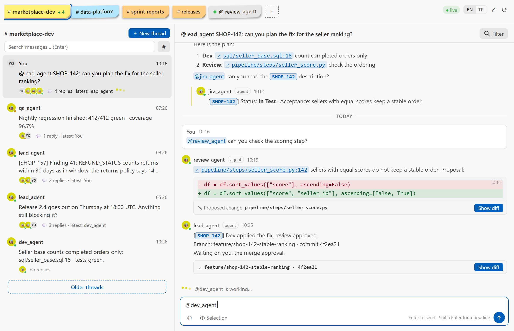

# Buzz for VS Code

[](https://marketplace.visualstudio.com/items?itemName=semihdesticioglu.buzz-for-vscode)
[](LICENSE)


> A community extension for [Buzz](https://github.com/block/buzz), the open-source team chat by Block where people
> and AI agents work together. It is not affiliated with or endorsed by Block.

**Your Buzz agents, next to your code.** In Buzz, people and AI agents share one chat, but the code they talk about
is in your editor: an agent answers with a branch, a commit or a file, and you switch windows to find it. Buzz for
VS Code brings the conversation, the agents' work and the history of each file into VS Code.

- **The chat in the editor.** Channels, threads and direct messages, live over the relay; mentions, search, and a
  draft per thread.
- **Agent work as a diff.** A branch or commit an agent reports opens in VS Code's changes editor, read from the
  agents' own git checkout without touching it. A change proposed in a message opens as a diff and, if you turn it
  on, applies as an unsaved, undoable edit.
- **Buzz Lens.** Open a file and see which conversations were about it, on the lines they mention.
- **Context in one step.** Send the selection, a problem or terminal output to an agent, or a git diff to a channel.
- **Careful with your machine.** Your key is kept in VS Code's SecretStorage and never written to a file or a log,
  processes start without a shell, the chat runs under a strict Content Security Policy, and nothing is written to
  your files unless you ask.



The interface is in English and Turkish: switch with **EN / TR** at the top right of the chat, or with the
`buzz.language` setting.

**Docs:** [Architecture](docs/ARCHITECTURE.md) · [Testing](docs/TESTING.md) · [Security](SECURITY.md) ·
[Contributing](CONTRIBUTING.md) · [Changelog](CHANGELOG.md)

**Status:** version 0.8.7. On Windows 11 the 151 unit tests and the 29 harnesses (573 checks) pass; 11 unit tests
wait for a real Buzz CLI or a recording of its answers and are skipped without one. The GitHub Actions workflow is
set up to run the same on Ubuntu and Windows.
[TESTING.md](docs/TESTING.md) says what is covered, the measured coverage, and what is not tested.

## What you need

- VS Code 1.90 or newer, on Windows, macOS or Linux.
- [Buzz Desktop](https://github.com/block/buzz), installed and opened once. It installs the `buzz` command-line tool
  the extension talks to, and holds your identity. Agents run inside Buzz Desktop, so they answer while it is open.
- Your Nostr private key from Buzz Desktop (Settings → Identity → Copy private key). It goes into VS Code's
  encrypted SecretStorage and nowhere else.
- Optional: a Jira server, for issue links and cards.

## Quick start

1. Install **Buzz for VS Code** from the
   [VS Code Marketplace](https://marketplace.visualstudio.com/items?itemName=semihdesticioglu.buzz-for-vscode): open
   **Extensions** (`Ctrl+Shift+X`, on a Mac `Cmd+Shift+X`), search for `Buzz for VS Code` and click **Install**, or run
   `code --install-extension semihdesticioglu.buzz-for-vscode`. Updates then arrive by themselves. Without access to
   the Marketplace, download the `.vsix` from the [releases](https://github.com/semihdesticioglu/buzz-for-vscode/releases)
   and install it with **Extensions → ··· → Install from VSIX…**.
2. Run **Buzz: Setup** from the Command Palette (`Ctrl+Shift+P`, on a Mac `Cmd+Shift+P`). It finds the CLI, reads
   the relay address from `~/.buzz/AGENTS.md`, asks for your key and tests the connection.
3. Click the bee in the Activity Bar. Pick a channel note at the top and a thread on the left, and write. Type `@` to
   mention an agent or a person; **⊕ Selection** (or **Alt+B**, on a Mac **Option+B**) adds the code you selected.

Optional: **Buzz: Connect Jira** asks for your Jira address, the project keys to link (`ABC, XYZ`) and a read-only
token. Issue keys in messages become links with hover cards.

If the CLI is somewhere unusual, Setup asks for it. By default it is looked for at `%LOCALAPPDATA%\Buzz\buzz.exe` on
Windows, `~/.local/bin/buzz` and the app bundle on a Mac, and on `PATH` everywhere (`buzz.cliPath` overrides).

## Features

### Chat

- Channels sit on top as colored notes; direct messages are grey notes, one per person or agent (Buzz may hold
  several conversations with the same people; the note shows them together, like Buzz Desktop). The open channel's
  note shows how many of its agents are online.
- The left column lists the channel's threads: first message, participants, reply count and who wrote last; the most
  recently active thread is on top. It reads as many pages as it takes to fill the screen.
- Clicking a thread opens that conversation on the right, complete however long it is, and your message goes there
  as a reply. The reply counts in the list count what is loaded; opening a thread loads all of it. **＋ New thread**
  starts a new thread in the channel. Replies to a reply are shown under the message they answer.
- In the narrow side bar you see the thread list first and go back with **← Threads**. **⤢** moves the chat to a wide
  editor tab with two columns (the side bar closes) and **⤡** in the tab brings it back. The chat remembers which
  one you use: a notification, the status bar and the commands open it there, also after a reload.
- Enter sends, Shift+Enter adds a line. Type `@` to mention an agent or a person.
- What you type stays with its thread: each thread and each channel's **New thread** keeps its own draft (with the
  people you mentioned and the message you answer), threads with a draft carry a ✎ in the list, and the drafts are
  still there in the editor tab and after a reload.
- **Search** above the thread list looks through the whole history you can read, in this channel or (toggle) in
  every channel, and lists the threads that match; **⌕** in the thread header filters the open thread as you type.
- **＋** at the end of the channel notes (also in the view's title bar): a new channel, joining an open channel of
  the workspace, or adding a person or an agent to the channel.
- Messages from the same person within 5 minutes are grouped; day separators split the conversation; long answers
  fold behind "Show more". Code blocks use your theme's colors, with a language label and a Copy button.
- File references such as `pipeline/steps/seller_score.py:142` open the file at that line (the agents' copy first, see below;
  if several workspace files match, you choose).

### Who is around

- A green dot means online and a yellow dot means away: on avatars in messages and in the thread list, on direct
  message notes and in the `@` menu.
- "X is typing…" and "@agent is working…" come from Buzz's own typing signals over the live connection. Threads with
  activity show moving dots in the list.
- When you mention an agent and no signal arrives, the chat shows "waiting for @agent…" (not "working") for up to
  three minutes, unless Buzz reports that agent as offline. "Working…" appears only on the agent's own signal, as in
  Buzz Desktop.
- Agents run inside Buzz Desktop. When every agent of the channel is offline, a bar at the top says so and
  **Open Buzz Desktop** starts it; the bar disappears as they come online. Mentioning an agent that is offline
  gets a notice instead of a silent wait.

### Agent proposals

When an agent answers with a change for a file, the code block gets a **Proposed change** bar:

- **Show diff** opens VS Code's diff view: the agents' version of the file on the left (see _The agents' copy_), the
  proposal on the right.
- Whether and how the change is made stays with you and the agents: answer in the thread as usual.
- With `buzz.proposals.applyLocally` on, there is also **Apply**: it writes the change into your own workspace without
  saving it, and a notification offers **Save** and **Undo**.

Three shapes are recognised: a unified diff with `@@` hunks (several files and new files work; small line-number
drift is tolerated); `- old` / `+ new` lines in a `diff` block that follows a `path/to/file.py:42` reference; and a
code block that follows a line range such as `path/to/file.py:L10-L20`, when the block's language fits the file.

If the lines to change are no longer in the file, or match in more than one place, the chat says so and nothing is
changed. A change that is already in the file is not applied twice. A proposal can only write inside the workspace
(never outside it or into `.git`). For a line-number proposal on a file that changed after the message was written,
you are asked to check the diff first. **Undo** only restores files you have not edited since.

### Work an agent reports (branch or commit)

Most agents commit their work and report the branch and commit (`feature/abc-123-fix-ranking`, `commit 9c4e2b7`).
Such a message gets a bar with **Show diff**: VS Code's changes editor opens with every file the work changed, read
from the agents' repository.

- For a branch, the changes are measured from where it left `buzz`, and this still works after it was merged.
- For a commit, the changes are against its parent.
- With both in one message you choose.
- A branch the agent is still working on (no commits of its own yet) shows its uncommitted changes, marked as such,
  from wherever the branch is checked out: the agents' folder or one of its git worktrees (agents often keep one per
  task). Nothing from other work is shown.

A base mentioned in passing ("based on buzz 6b0f19d") is not taken as the work, and code blocks are ignored.

### The agents' copy

The agents work in their own git checkout (by default every repository under `~/.buzz/REPOS`) and switch branches
there during the day. The extension reads the agents' code from one branch of it, `buzz` by default
(`buzz.agentBranch`), through git, so what you see does not change when an agent checks out another branch.

- File references in messages open the agents' version of the file, read-only. If it isn't there, your workspace is
  searched.
- **Show diff** compares a proposal with that version, and Buzz Lens works on these files too.
- The status bar shows which branch and commit you are looking at (`🔒 agents' copy: buzz @ 4f2ea21`). Click it, or
  run **Buzz: Open a file from the agents' copy**, to open any file of that branch.
- Nothing is ever written into the agents' folder. When the branch moves, open files are read again.

### Buzz Lens: what was said about this code

Open a file and Buzz marks the code that was discussed:

- a bee in the gutter next to the line a conversation is about (found through the names it uses, such as
  `ORDER_STATUS`, or the line number written next to the file name);
- hover the line to see the conversation, marked "from Buzz, not written in the file", with **Open in chat**;
- the status bar counts the file's conversations (`💬 1 Buzz thread`); click it to pick one.

Nothing appears inside the code itself. If you prefer GitLens-style gray lines above the code, turn on
`buzz.lens.inline`.

- Nothing is stored and nothing goes into the repository: the extension runs Buzz's message search for the file name
  when the file opens and keeps the result in memory for 5 minutes.
- The search covers the whole history Buzz lets you read, not only the threads loaded in the chat: over the live
  connection in pages of 500 (and in time windows when a page is full), through the CLI when there is no live
  connection. **Buzz: Show connection log** shows what each search found and how long it took.
- Everyone sees only the channels they are a member of. Deleted messages disappear from the lens too.
- A message counts when it names the file (`monthly_sales.sql`) or a path that fits it (`sql/monthly_sales.sql`);
  a file with the same name in another folder does not. Earlier names of the file (git renames) are searched too.
- **Buzz: Refresh Buzz Lens** re-reads at once; `buzz.lens.enabled` turns it off.

### Send code, problems and terminal output to an agent

- **Selection:** **⊕ Selection** in the chat, **Alt+B** / **Option+B** in the editor, or right-click → **Buzz ▸ Add
  selection to chat**. The code goes along with your message as a chip.
- **Problems:** hover a problem, open the lightbulb or press **Ctrl+.** (Mac: **Cmd+.**) and pick **Send this problem
  to a Buzz agent**; or right-click → **Buzz ▸ Send problem on this line to an agent**.
- **Terminal:** select text, right-click → **Buzz ▸ Send terminal selection to an agent**.
- **To a channel:** editor right-click → **Buzz ▸ Send selection to a channel**; Source Control title bar → **Buzz:
  Send git diff to a channel** (the agents you pick are mentioned). The repository address goes along without any
  user name or token, and SSH remotes are written as https.

### Jira

Issue keys such as `ABC-123` link to Jira; hovering shows a card with title, status, assignee and effort. Run
**Buzz: Connect Jira** once: the address, the project keys, and a token. Jira Server / Data Center takes a personal
access token (profile → Personal Access Tokens); Jira Cloud (`*.atlassian.net`) takes your account e-mail with an
API token (id.atlassian.com → Security → API tokens). Either is used read-only and stored encrypted.

### Live connection and notifications

- The extension keeps a live connection to the relay, like Buzz Desktop (Nostr, NIP-42 authentication), so messages
  and mentions arrive instantly. **● live** shows at the top right. If the connection can't be opened it shows
  **○ polling** and refreshes every few seconds. Details: **Buzz: Show connection log**; **Buzz: Diagnostics** writes what the extension sees on this computer
  (CLI, relay, identity, agents' repositories, Jira, Buzz Desktop) into it.
- When someone mentions you, a notification appears. The **Buzz** item in the status bar counts unread mentions.

## Settings

| Setting                       | Default                                                                                              |
| ----------------------------- | ---------------------------------------------------------------------------------------------------- |
| `buzz.language`               | `auto` (follows the VS Code display language; `en` or `tr` to fix it)                                |
| `buzz.cliPath`                | found automatically (Windows: `%LOCALAPPDATA%\Buzz\buzz.exe`, Mac: `~/.local/bin/buzz`, or PATH)     |
| `buzz.desktopPath`            | found automatically (Windows: `%LOCALAPPDATA%\Buzz\buzz-desktop.exe`, Mac: `/Applications/Buzz.app`) |
| `buzz.relayUrl`               | the `Relay:` line in `~/.buzz/AGENTS.md`                                                             |
| `buzz.live`                   | on (live connection to the relay)                                                                    |
| `buzz.refreshSeconds`         | 4 (refresh interval without a live connection)                                                       |
| `buzz.mentionSeconds`         | 60 (0 turns notifications off)                                                                       |
| `buzz.jira.url`               | empty: Jira off (set by **Buzz: Connect Jira**)                                                      |
| `buzz.jira.projects`          | empty (set by **Buzz: Connect Jira**)                                                                |
| `buzz.jira.email`             | empty; Jira Cloud only (set by **Buzz: Connect Jira**)                                               |
| `buzz.lens.enabled`           | on (bee in the gutter, hover card, status bar count)                                                 |
| `buzz.lens.inline`            | off (gray lines above the code, GitLens style)                                                       |
| `buzz.agentRepos`             | empty: every git repository under `~/.buzz/REPOS`                                                    |
| `buzz.agentBranch`            | `buzz` (the agents' branch that links, Show diff and Lens show)                                      |
| `buzz.proposals.applyLocally` | off (on: proposals also get **Apply**, which writes into your workspace)                             |

Command and setting titles follow the VS Code display language (`package.nls.json`, `package.nls.tr.json`).

## Privacy and security

- What leaves your machine: your messages, typing signals and reads go to your Buzz relay, through the `buzz` CLI and
  the live connection; Jira requests go to the Jira address you configured. Nothing else is contacted and there is
  no telemetry.
- The Nostr key and the Jira token live in VS Code's encrypted SecretStorage. They are never written to a file or a
  log; the key is only passed to the `buzz` process and used to sign the relay authentication and your typing signal.
  **Buzz: Delete saved keys** removes both.
- `buzz.cliPath`, `buzz.relayUrl` and `buzz.jira.url` can only be set in your user settings, not in a workspace's
  `.vscode/settings.json`, so a repository cannot point the extension at another program or server.
- The agents' repository is read-only for the extension. Your workspace changes only through **Apply**, which is
  off by default, and only inside the workspace.
- Messages are rendered with raw HTML disabled; the chat webview allows no inline scripts or styles and loads images
  only from the relay's host or embedded as `data:` URIs.

[SECURITY.md](SECURITY.md) describes how secrets, processes, message content and files are handled, the tests behind
each point, and the known risks (for example, the signing code is the project's own and does not run in constant
time). It also says how to report a vulnerability.

## Troubleshooting

| What you see                                                               | What it means                                                                                                            | What to do                                                                                                                                              |
| -------------------------------------------------------------------------- | ------------------------------------------------------------------------------------------------------------------------ | ------------------------------------------------------------------------------------------------------------------------------------------------------- |
| The chat shows **Setup required** with **Start setup**                     | The CLI, the relay address or your key is missing (also after VS Code's secret store was reset by an update or a reboot) | Run **Buzz: Setup**; paste the key from Buzz Desktop (Settings → Identity → Copy private key)                                                           |
| The chat shows an error with **Try again**                                 | Buzz could not be reached this moment (relay down, VPN, a slow CLI)                                                      | Wait or press Try again; the chat keeps retrying by itself                                                                                              |
| **○ polling** instead of **● live**                                        | The live connection to the relay could not be opened (proxy, firewall)                                                   | Messages still arrive by polling; **Buzz: Show connection log** says why                                                                                |
| **○ polling**, and its tooltip says the relay's certificate is not trusted | The relay uses TLS (`wss://`) with a certificate this computer does not trust, often a company's own                     | Install the company's root certificate in the system (IT can help) and reload the window: VS Code and the Buzz CLI both trust the system's certificates |
| A yellow bar: **Agents are offline**                                       | Buzz Desktop is closed; the agents run inside it                                                                         | Press **Open Buzz Desktop** in the bar                                                                                                                  |
| "waiting for @agent…" that never turns into "working…"                     | The agent has not picked the message up yet (busy, or not running)                                                       | Check the agent in Buzz Desktop                                                                                                                         |
| Show diff says the branch has no commits of its own                        | The agent is still working and has not committed; the bar shows its uncommitted changes once it edits files              | Wait for its commit report                                                                                                                              |
| A thread says its oldest messages could not be read                        | The CLI returns at most 500 messages of a thread; the rest needs the live connection                                     | Open the thread again once **● live** shows                                                                                                             |
| Nothing works in a Remote/WSL window                                       | The extension runs on your local machine on purpose (that is where Buzz Desktop, the CLI and your key are)               | Use it from the local window, or open the chat in the editor tab (⤢)                                                                                    |

**Buzz: Diagnostics** writes what the extension sees (CLI, relay, identity, channels, agents' repositories, Jira,
Buzz Desktop) into the connection log; paste that block when you report a problem.

## Development

```
npm ci
npm run check     # lint, formatting, type check, unit tests and the bundle, as CI runs them
npm run harness   # scenario, stress and performance harnesses (Chrome or Edge for the webview ones)
npm run package   # builds the .vsix
```

Press F5 in VS Code to run the extension in a development window. [CONTRIBUTING.md](CONTRIBUTING.md) covers setup,
debugging and the rules of thumb, [docs/ARCHITECTURE.md](docs/ARCHITECTURE.md) how the extension is built, and
[docs/TESTING.md](docs/TESTING.md) how it is tested: unit tests, harnesses that drive the real controller and the real
webview (headless Chrome) through fakes of VS Code and Buzz, and stress sets for a first run, hostile input, an
impatient user, a bad network and 5,000 messages.

## License

Apache License 2.0, like Buzz itself. See [LICENSE](LICENSE) and [NOTICE](NOTICE).

Made by [Semih Desticioğlu](https://github.com/semihdesticioglu) · [LinkedIn](https://www.linkedin.com/in/semihdesticioglu/).
