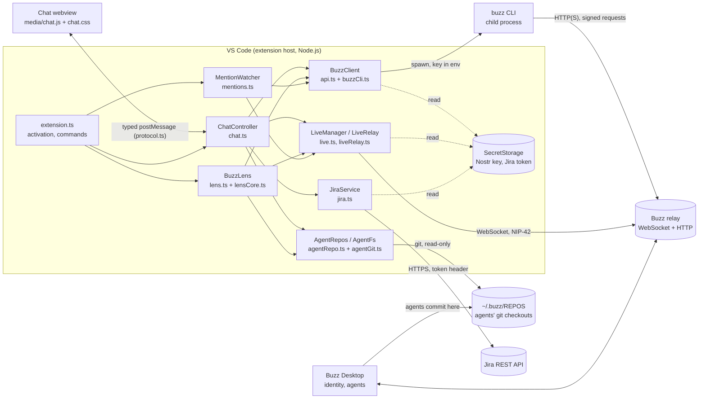
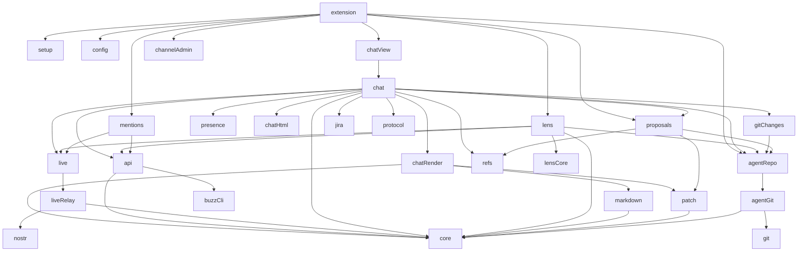
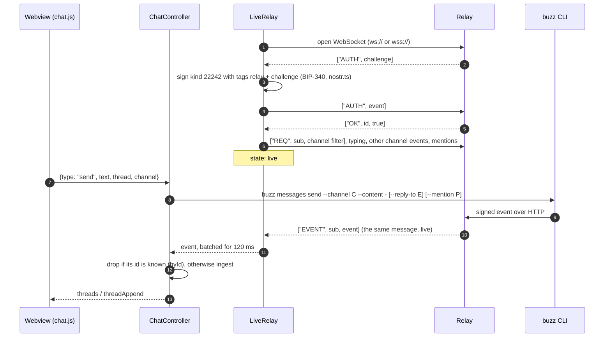
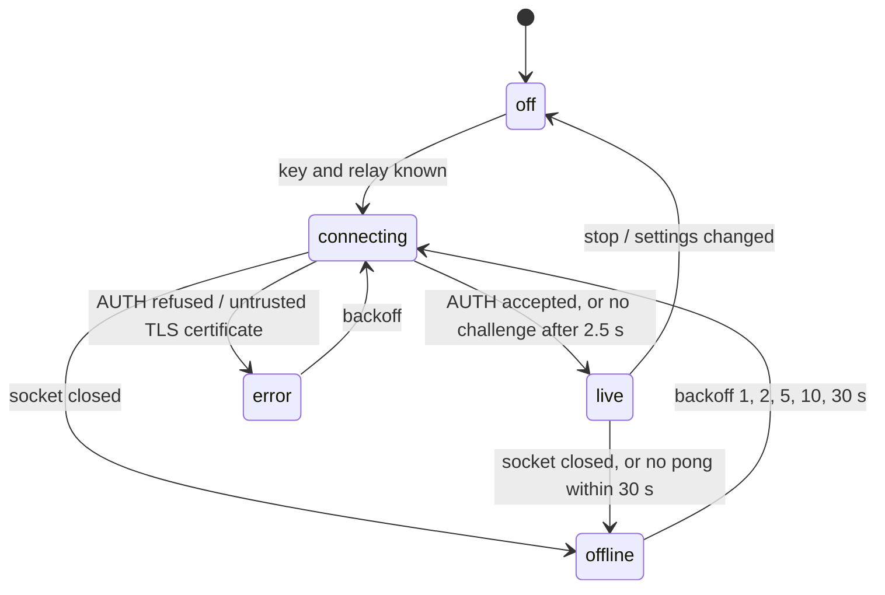
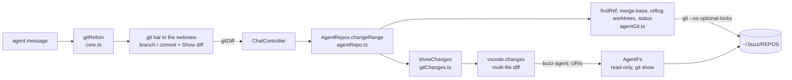
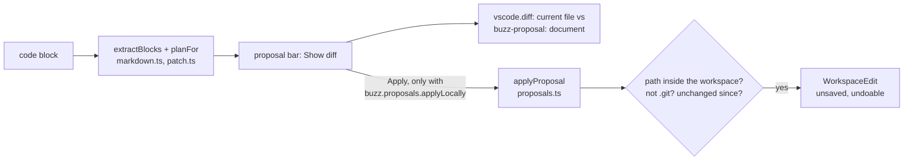
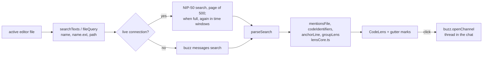

# Architecture

This document describes how Buzz for VS Code is built: what runs where, how it talks to Buzz, and why. Every
component named here is a file in `src/` or `media/`; numbers (page sizes, timeouts) are constants in the code and
are quoted with the file they come from.

Contents: [Overview](#overview) · [Modules](#modules) · [Two ways to Buzz](#two-ways-to-buzz-the-cli-and-the-relay) ·
[Authentication and delivery](#authentication-and-message-delivery) · [Failure and recovery](#failure-and-recovery) ·
[Threads, pages and duplicates](#threads-pages-ordering-and-duplicates) · [Agent work in Git](#agent-work-in-git-show-diff) ·
[Proposals](#agent-proposals) · [Buzz Lens](#buzz-lens) · [Webview](#the-webview) ·
[Credentials](#credentials-and-trust-boundaries) · [Decisions and limits](#design-decisions-and-limitations)

## Overview

[Buzz](https://github.com/block/buzz) is a Nostr-based team chat where people and AI agents work together. Its
pieces that matter here are a **relay** (WebSocket + HTTP), **Buzz Desktop** (the app that holds the user's identity
and runs the agents), and the **`buzz` CLI** that Buzz Desktop installs. The extension is a chat client and a code
bridge: it shows channels and threads inside VS Code, and connects what agents say to the code they work on.

The extension runs as a **UI extension** (`"extensionKind": ["ui"]` in `package.json`): on the user's own machine,
where Buzz Desktop, the CLI, the key and the agents' checkouts are, also in a Remote/WSL window.

## Modules

`extension.ts` creates each long-lived object once and passes it to the parts that need it; there are no
module-level singletons apart from the log channel and the UI language. Modules that do not import `vscode` are
unit tested directly (see [TESTING.md](TESTING.md)).

| Area            | Files                                                                                                                             | Responsibility                                                                                       |
| --------------- | --------------------------------------------------------------------------------------------------------------------------------- | ---------------------------------------------------------------------------------------------------- |
| Activation      | `extension.ts`, `setup.ts`, `config.ts`, `diagnostics.ts`                                                                         | Wiring, commands, first-run setup, settings, auto-discovery of the CLI and the relay                 |
| Chat            | `chat.ts` (controller), `chatView.ts` (side bar view or editor tab), `chatHtml.ts`, `chatRender.ts`, `presence.ts`, `protocol.ts` | Channels, threads, paging, sending, live events, who is online, typing and "working"                 |
| Webview         | `media/chat.js`, `media/chat.css`                                                                                                 | The chat UI: channel notes, thread list, thread, composer, search, drafts                            |
| Buzz access     | `api.ts`, `buzzCli.ts`, `live.ts`, `liveRelay.ts`, `nostr.ts`                                                                     | CLI commands; live WebSocket with NIP-42 authentication; event signing (BIP-340)                     |
| Pure logic      | `core.ts`, `markdown.ts`, `patch.ts`, `lensCore.ts`, `agentGit.ts`, `i18n.ts`                                                     | Parsing, grouping, rendering, diff planning, Lens matching, git ranges, strings (no `vscode` import) |
| Code bridge     | `agentRepo.ts`, `agentGit.ts`, `gitChanges.ts`, `proposals.ts`, `refs.ts`, `lens.ts`, `sendCode.ts`, `problems.ts`                | The agents' repositories, Show diff, proposals, file links, Buzz Lens, sending code and problems     |
| Around the chat | `mentions.ts`, `channelAdmin.ts`, `desktop.ts`, `jira.ts`, `log.ts`                                                               | Mention notifications, channel management, starting Buzz Desktop, Jira cards, the output channel     |

## Two ways to Buzz: the CLI and the relay

The extension reaches Buzz in two ways and uses each for what it does best.

|          | `buzz` CLI (`api.ts`, `buzzCli.ts`)                                                                                                                                                                           | Live relay connection (`live.ts`, `liveRelay.ts`)                                                                                                                                                      |
| -------- | ------------------------------------------------------------------------------------------------------------------------------------------------------------------------------------------------------------- | ------------------------------------------------------------------------------------------------------------------------------------------------------------------------------------------------------ |
| What     | A child process per command: `messages get/thread/send/send-diff/search`, `channels list/members/create/join/add-member`, `dms list`, `users get/presence`, `feed get`                                        | One WebSocket to the relay, authenticated with NIP-42                                                                                                                                                  |
| Used for | Every write (sending messages and diffs), channel and DM lists, members, presence, the mention feed, the first page of a channel, threads up to 500 messages, and every read when the live connection is down | Instant delivery (subscriptions), typing signals, history pages of 200, threads beyond 500 messages, missing thread roots, full-text search (NIP-50) for Lens and the search box, the member directory |
| Cost     | About half a second to a second per call (a process start)                                                                                                                                                    | Milliseconds once connected                                                                                                                                                                            |
| Failure  | Exit codes and JSON errors on stderr, mapped to typed `BuzzError`s (`core.ts`)                                                                                                                                | State `off / connecting / live / offline / error`; one-shot reads say whether they are complete                                                                                                        |

**Why both.** The CLI is the interface Buzz supports: it knows Buzz's message format (mentions, replies, diffs),
signs and sends, and follows Buzz's changes. But a process per call is too slow for a chat that should feel live,
and polling alone cannot show messages the moment they arrive. The WebSocket gives instant events and fast paged
reads; when it is down (VPN, proxy, a relay that refuses it), the chat keeps working on the CLI alone by polling.
Writes always go through the CLI, so there is one path that decides how a message looks.

## Authentication and message delivery

The relay address comes from the `buzz.relayUrl` setting or the `Relay:` line Buzz Desktop writes to
`~/.buzz/AGENTS.md` (`config.ts`). The CLI gets it as `BUZZ_RELAY_URL` (`http(s)://`); the WebSocket uses the same
address as `ws(s)://` (`nostr.ts`, `wsUrl`).

- A relay that sends no challenge is treated as not needing authentication after 2.5 s (`authWaitMs`).
- The key is signed with locally (`nostr.ts`); only signatures leave the machine. The AUTH event names the relay
  address and the one-time challenge, so it cannot be replayed elsewhere.
- The message is sent with the channel and thread that were on screen when Enter was pressed. If the user switched
  channels in the meantime, it still goes there (`sendElsewhere` in `chat.ts`); for a DM note that stands for several
  conversations, into the conversation its thread lives in.

## Failure and recovery

What keeps the chat correct while the connection changes (`chat.ts`, `liveRelay.ts`):

- **Polling never stops.** Without the live connection the channel is read every `buzz.refreshSeconds` (default 4 s),
  2.5 s while an agent's answer is expected; with it, every 30 s as a safety net (`POLL_LIVE_MS`).
- **Catch-up.** On every return to `live` the subscriptions are sent again (with their original `since`) and the
  channel is read once over the CLI.
- **Reconciliation.** Every 60 s the latest page is read again to apply deletions and edits made elsewhere; a channel
  event that is not a message (reaction, deletion, member change) triggers the same read after 1.5 s.
- **One-shot reads know whether they are complete.** `LiveRelay.query` resolves with `complete: true` only after the
  relay's EOSE; a timeout, a CLOSED or a dropped socket gives `complete: false` with what did arrive, and the caller
  falls back to the CLI or marks the thread as partial.
- **Heartbeat.** A socket that dies silently (sleep, VPN switch) is detected by an unanswered ping and replaced.
- **Backoff resets only after 30 s of a stable connection**, so a flapping relay is not hammered.
- **Certificates.** A relay whose TLS certificate the machine does not trust ends in `error` with
  `reason: 'certificate'`, shown as such in the webview.
- **CLI failures** are typed: missing CLI or key opens setup; a network failure shows a status line and retries; a
  command that hangs is stopped after 30 s.

## Threads, pages, ordering and duplicates

- **One store per channel.** `ChatController.byId` holds every message of the open channel by event id. Messages from
  the CLI pages, the live subscription, thread reads and catch-up reads all pass through `ingest`, which skips known
  ids; the open thread is extended only with messages it has not shown (`shown`).
- **Threads.** A message's root is its `e` tag marked `root` (NIP-10); `groupThreads` (`core.ts`) groups by root and
  sorts threads by latest activity. Inside a thread, `threadOrder` places replies under the message they answer,
  ordered by `created_at` and then by id.
- **Pages.** A channel opens with the latest 100 messages per conversation (`PAGE`); more pages are read until at
  least 30 threads show (`MIN_THREADS`, at most 10 extra pages). "Older threads" reads 200 at a time over the live
  connection (`LIVE_PAGE`), otherwise 100 over the CLI. A page shorter than asked for is the end; a page that only
  repeats known messages moves the cursor on (up to 5 pages, `OLDER_PASSES`).
- **Long threads.** The CLI returns at most 500 messages of a thread (`THREAD_PAGE`); the rest is read over the live
  connection in pages of 500 (up to 20). A thread whose oldest part could not be read is marked partial.
- **Malformed rows.** CLI rows that are not messages (null, a number for content, no key or time) are dropped where
  the output is read (`api.ts`, `eventPage` in `core.ts`) but still count toward the page size, so they cannot end
  paging early; each is logged once.
- **DM notes.** Buzz may hold several conversations with the same people; one note stands for all of them (up to 6
  read together, `MAX_CONVERSATIONS`). A reply goes into the conversation its thread lives in.

## Agent work in Git: Show diff

Agents keep a checkout per repository under `~/.buzz/REPOS` and work on a branch (`buzz.agentBranch`, default `buzz`),
often in a linked worktree per task. When a message names a branch or a commit, the extension can show exactly that
work, without touching the agents' folders.

- **What a branch's work is.** An open branch: everything since it left the agents' branch (merge-base). A merged
  branch: what its merge commit brought in. A fast-forwarded branch: its last commit, found through the reflog. A
  branch with no commits of its own: the uncommitted work of the folder or linked worktree where it is checked out
  (`git status --porcelain=v2`). A commit: against its first parent.
- **Read-only by construction.** Every git command runs with `--no-optional-locks` (no index refresh is written),
  paths are passed as `:(literal)` pathspecs, refs are checked by `isValidRef` before they reach git (no `..`, no
  leading `-`), and the `buzz-agent:` file system refuses writes.

## Agent proposals

A code block in an agent's message can be a proposal: a unified diff, a loose `- old / + new` diff, or a block placed
after a `path:L10-L20` reference (`patch.ts`, `extractBlocks` in `markdown.ts`).

The proposal is always computed by the extension from the message it holds; the webview only names the message and
the block. Applying is off by default, refuses paths outside the workspace and inside `.git`, asks when the file
changed after the message was written, and leaves the edit unsaved.

## Buzz Lens

Lens shows above a file which Buzz conversations talk about it, and gutter marks on the lines they mention.

Search order is relevance (Buzz uses Postgres full-text search), so when a page of 500 is full the history is read
again in time windows to keep old conversations. Results are cached per file for 5 minutes (`lens.ts`).

## The webview

- One script, `media/chat.js`, and one stylesheet. The HTML (`chatHtml.ts`) carries a Content Security Policy:
  `default-src 'none'`, scripts only with a per-load nonce, styles only from the extension, images only from the
  relay's host and data URIs. There are no inline styles or handlers.
- Message HTML is produced in the extension by markdown-it with `html: false` (raw HTML is escaped, `javascript:`
  links are refused); blocks nest at most 20 levels and deeper text is kept as plain text (`markdown.ts`).
- Extension and webview speak the typed messages of `protocol.ts`. Actions with side effects carry ids, not content:
  the extension looks up the message, validates paths (`isSafeRel`) and opens only `http(s)` URLs.
- The same controller drives the side bar view and an editor tab (`chatView.ts`); drafts per thread are kept in the
  workspace state so both see them.

## Credentials and trust boundaries

| Secret            | Where it lives                                  | Where it goes                                                                                                                                                   |
| ----------------- | ----------------------------------------------- | --------------------------------------------------------------------------------------------------------------------------------------------------------------- |
| Nostr private key | VS Code SecretStorage (the OS credential store) | In memory of the extension host for signing; to each CLI process as `BUZZ_PRIVATE_KEY` in its environment (never on the command line); never to a file or a log |
| Jira token        | SecretStorage                                   | Only the `Authorization` header of read requests to the configured Jira address                                                                                 |

Settings that point to programs or servers (`buzz.cliPath`, `buzz.desktopPath`, `buzz.agentRepos` are `machine`;
`buzz.relayUrl`, `buzz.jira.url` are `application` scoped) cannot be set by a workspace's `.vscode/settings.json`.
Process execution uses `spawn`/`execFile` with argument arrays (no shell); user text that could look like an option
is passed as one `--name=value` argument. See [SECURITY.md](../SECURITY.md) for the risks that remain.

## Design decisions and limitations

- **CLI for writes, WebSocket for reads.** Keeps one supported path for what a message is, and an independent path
  for speed. The price is two code paths to keep consistent; deduplication by event id and the reconciliation read
  are what make that safe.
- **No local database.** Each channel is read when opened; nothing of the conversation is stored on disk. Simpler
  and private, at the cost of a read per channel switch.
- **Own BIP-340 implementation.** `nostr.ts` signs with plain BigInt arithmetic, because the `crypto` module of
  VS Code's Electron runtime has no secp256k1. It passes all 19 official BIP-340 test vectors and matched
  `@noble/curves` byte for byte on random inputs in a one-off comparison, but it is **not constant-time** and is over
  ten times slower than that library. Replacing it with `@noble/curves` (pure JavaScript, so it also runs in
  Electron) is the recommended next step (see SECURITY.md).
- **Incoming events are not signature-checked.** The extension trusts the relay it authenticated to, as the CLI does.
  Over an unencrypted `ws://` relay this leaves injected events undetected.
- **The key must be given to the extension.** The CLI accepts it only from the environment or a flag. Buzz is
  designing a local credential provider (Buzz Desktop signs, the key stays there); once it ships, the extension can
  pair instead of storing the key.
- **Catch-up after a long outage** reads the latest 50 messages over the CLI; if more were missed and the live
  replay did not bring them, the gap closes only when the channel is opened again.
- **Messages with the same `created_at`** keep their arrival order in the thread list and the reply list (the thread
  view orders them by id).
- **Windows, macOS and Linux** are supported; the agents' features need the repositories Buzz Desktop keeps under
  `~/.buzz/REPOS`.
